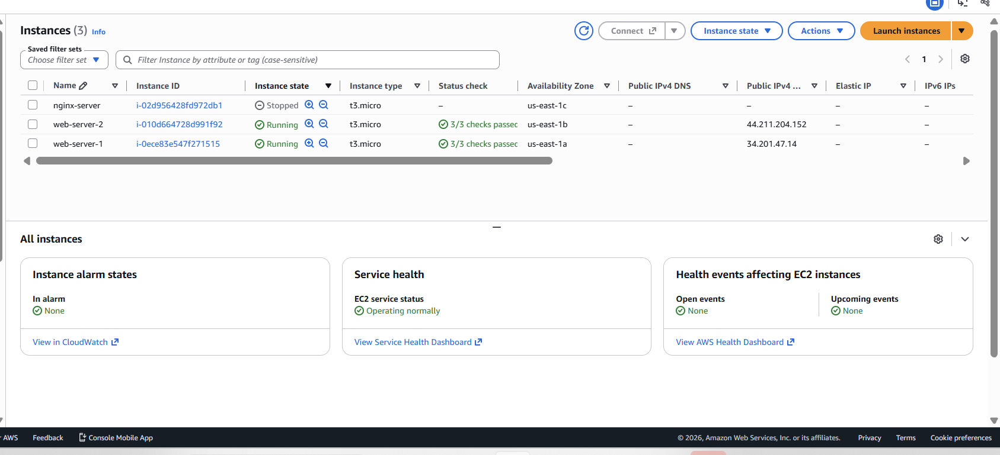
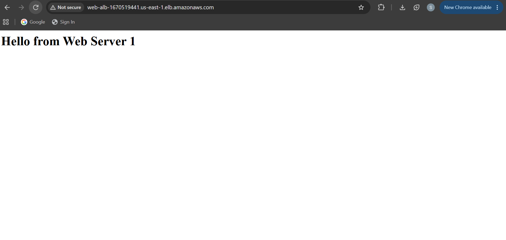
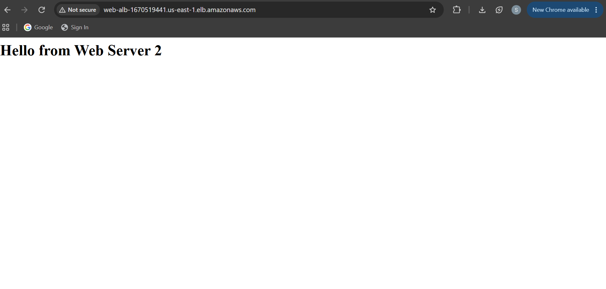

# AWS Application Load Balancer Project

## Overview

Configured an AWS Application Load Balancer (ALB) to distribute HTTP requests across two EC2 web servers deployed in separate Availability Zones.

The project demonstrates how a single load balancer endpoint can route requests to multiple backend servers.

## Technologies Used

- **Amazon EC2** — Hosted two web servers
- **Application Load Balancer (ALB)** — Distributed incoming HTTP requests
- **AWS VPC Networking** — Provided network connectivity for the instances and load balancer
- **Security Groups** — Controlled network access
- **AWS Management Console** — Configured and verified the infrastructure

## What I Did

- Launched two `t3.micro` EC2 instances named `web-server-1` and `web-server-2`.
- Deployed the instances across `us-east-1a` and `us-east-1b`.
- Configured an Application Load Balancer to route requests to the web servers.
- Configured separate server responses to identify which backend handled a request.
- Accessed the application using the ALB's DNS endpoint.
- Verified that requests reached both web servers.

## What Changed

**Before:** Each EC2 instance had its own public IP address and could be accessed separately.

**After:** The Application Load Balancer provided one common endpoint through which requests could reach either backend server.

This demonstrated how load balancing separates the public application entry point from individual EC2 instances.

## Results and Verification

- Both EC2 web servers were running and passed their instance status checks.
- Both instances were deployed in different Availability Zones.
- Accessing the same ALB DNS endpoint returned:
  - `Hello from Web Server 1`
  - `Hello from Web Server 2`
- Confirmed that HTTP traffic successfully reached both backend servers.

## Screenshots

### EC2 Instances

### Web Server 1

### Web Server 2

## Key Takeaways

- Practiced deploying multiple EC2 instances across Availability Zones.
- Understood how an Application Load Balancer provides a common entry point for multiple servers.
- Verified traffic distribution by observing responses from different backend instances.
- Gained hands-on experience with AWS compute and networking.

**Scope:** This lab demonstrates HTTP load balancing. HTTPS, automatic scaling, and production-grade fault tolerance were not verified as part of the documented results.