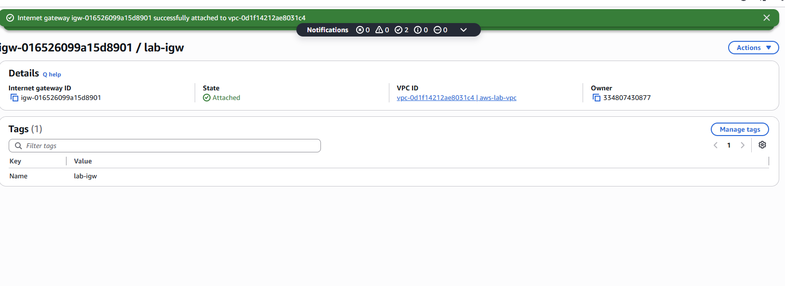
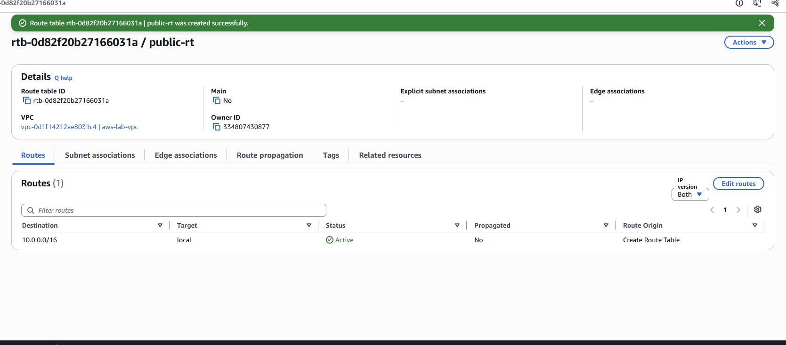

# AWS VPC Networking Lab

## Overview

Practiced configuring AWS networking resources by working with a Virtual Private Cloud (VPC), attaching an Internet Gateway, and creating a custom route table.

The objective was to understand how AWS networking components connect and how routing controls traffic within a VPC.

## Tools & Technologies

- **Amazon VPC** — Network isolation and IP addressing
- **Internet Gateway (IGW)** — Gateway for internet connectivity
- **Route Tables** — Network traffic routing
- **AWS Management Console** — Manual infrastructure configuration

## What I Did

- Worked with a custom VPC named `aws-lab-vpc`.
- Attached an Internet Gateway named `lab-igw` to the VPC.
- Created a custom route table named `public-rt`.
- Inspected the route table and its local VPC route.
- Reviewed how internet gateways, route tables, and VPCs work together.

## What Changed

**Before:** The VPC networking setup did not have the demonstrated gateway attachment and custom route table configuration.

**After:**

- Successfully attached the Internet Gateway to the VPC.
- Created a separate route table for managing network routes.
- Verified the networking resources using the AWS Console.

## Results & Verification

- Confirmed successful Internet Gateway attachment to `aws-lab-vpc`.
- Verified creation of the `public-rt` route table.
- Observed the VPC's local route, allowing traffic to be routed within its CIDR range.

### Evidence

**Internet Gateway Attachment**

**Custom Route Table**

## Technical Notes

- A VPC provides a logically isolated network in AWS.
- An Internet Gateway can provide a path between a VPC and the internet.
- Route tables determine where network traffic is directed.
- Creating a route table named `public-rt` does not automatically make a subnet public.

**Verification limitation:** The screenshots confirm the gateway attachment and route table creation. They do not establish that a default route to the Internet Gateway was added, that a subnet was associated with the route table, or that internet connectivity was successfully tested.

## Key Takeaways

- Gained practical experience with foundational AWS networking resources.
- Understood the relationship between VPCs, Internet Gateways, and route tables.
- Practiced making and verifying networking changes using the AWS Management Console.
- Built foundational knowledge for deploying applications inside custom AWS networks.