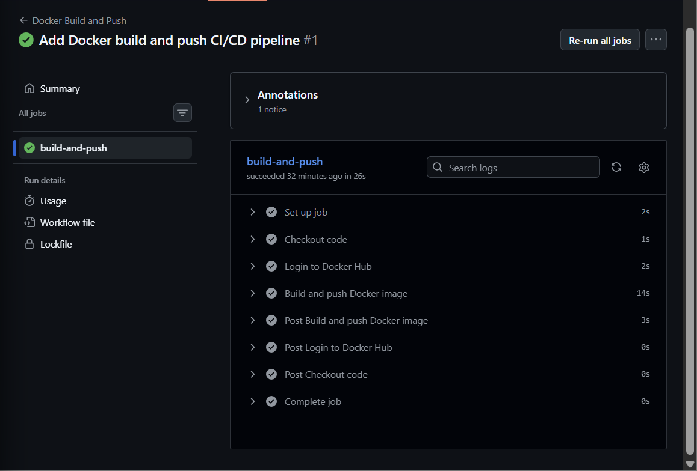
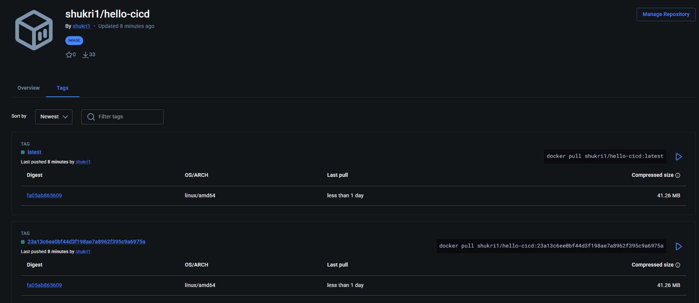
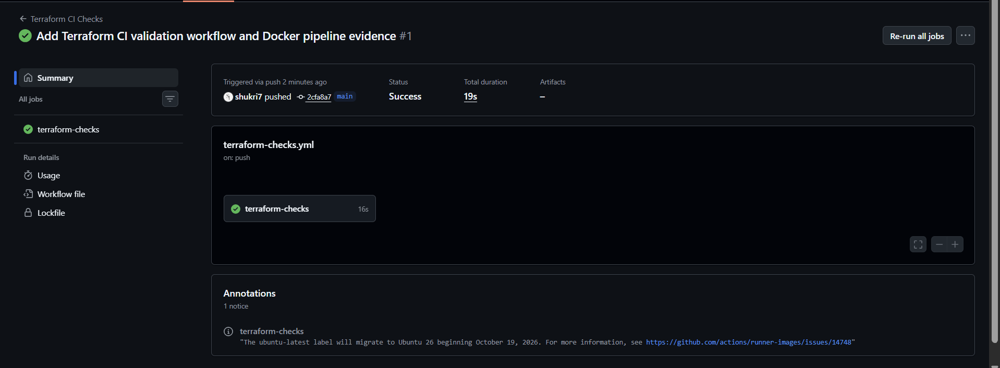

# CI/CD Automation with GitHub Actions

## Overview

Built two CI/CD automation workflows using **GitHub Actions** to automate Docker image builds and Terraform configuration checks.

The goal was to replace manual development tasks with repeatable pipelines triggered by changes to the GitHub repository.

## Tools & Technologies

- **GitHub Actions:** Automated workflow execution
- **Docker:** Building and running container images
- **Docker Hub:** Publishing and storing Docker images
- **Terraform:** Infrastructure as Code validation
- **Git & GitHub:** Version control and workflow triggers
- **YAML:** Defining CI/CD pipelines

## 1. Docker Build & Push Pipeline

### What I Did

- Created a simple Python application and Dockerfile using `python:3.12-slim`.
- Built and ran the Docker image locally to verify the application worked.
- Created a public Docker Hub repository: `shukri1/hello-cicd`.
- Configured GitHub Actions to automatically build and push Docker images when relevant files change on `main`.
- Used GitHub repository secrets to authenticate securely with Docker Hub.
- Tagged images with both the Git commit SHA and `latest`.

### What Changed

**Before:** Docker images had to be built and uploaded manually.

**After:** GitHub Actions automatically builds and publishes a new image when relevant changes are pushed to `main`.

### Results

- Docker build-and-push pipeline completed successfully in **26 seconds**.
- Verified that both image tags were published to Docker Hub.
- Confirmed the image was available for download on `linux/amd64`.

**Docker Hub:** [shukri1/hello-cicd](https://hub.docker.com/r/shukri1/hello-cicd)

### Evidence





## 2. Terraform CI Validation Pipeline

### What I Did

- Created a Terraform configuration defining an example AWS VPC.
- Built a GitHub Actions workflow to automatically run Terraform checks.
- Configured the workflow to run on relevant pushes, pull requests, or manual execution.
- Added the following validation commands:

```bash
terraform fmt -check -recursive
terraform init -backend=false -input=false
terraform validate -no-color
```

### What Changed

**Before:** Terraform formatting and configuration checks had to be executed manually.

**After:** GitHub Actions automatically runs these checks when relevant Terraform files change, helping identify problems before deployment.

### Results

- Terraform formatting check passed locally with exit code `0`.
- GitHub Actions validation pipeline completed successfully in **19 seconds**.
- Verified the Terraform configuration without provisioning any AWS resources.

### Evidence



## Key Takeaways

- Automated repeatable tasks using GitHub Actions instead of relying on manual commands.
- Used GitHub secrets to authenticate to Docker Hub without exposing credentials in source code.
- Used commit SHA tags to make Docker images traceable to source-code versions.
- Used path-based workflow triggers to keep Docker and Terraform checks separate.
- Implemented automated Terraform formatting and validation checks without deploying infrastructure.

**Note:** These workflows automate image publication and infrastructure validation. They do not deploy an application to AWS. The next step is extending CI/CD to automate an ECS deployment.

## Project Files

```text
.github/workflows/
├── docker-build-push.yml
└── terraform-checks.yml

cicd/
├── README.md
├── docker-build-push/
│   ├── Dockerfile
│   └── hello.py
├── terraform-checks/
│   └── main.tf
└── screenshots/
    ├── docker-workflow-success.png
    ├── dockerhub-tags.png
    └── terraform-workflow-success.png
```
