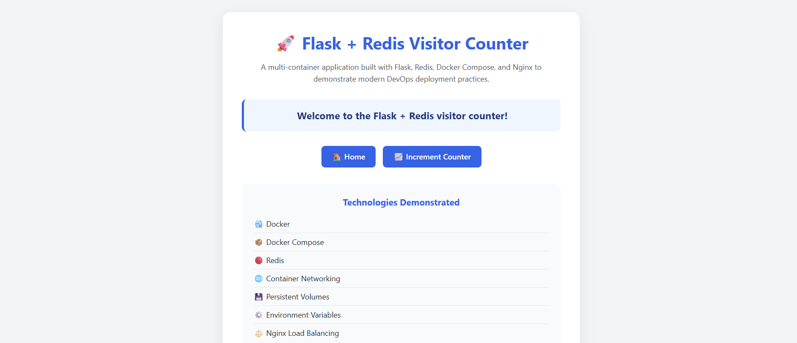
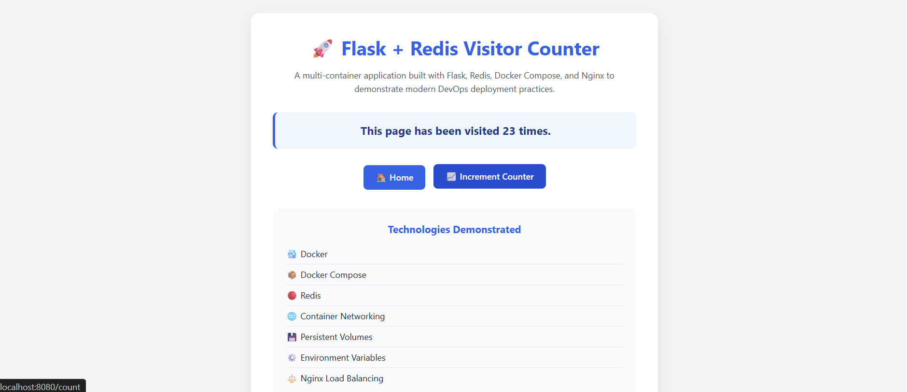

# 🐳 Flask + Redis Visitor Counter

## Project Overview

Built a multi-container Flask application using Docker Compose, Redis, and Nginx to practice container networking, reverse proxying, persistent storage, and scaling.

The application displays a visitor counter backed by Redis and runs across three Flask containers behind a single Nginx entry point.

## Technologies Used

- Python and Flask
- Docker and Docker Compose
- Redis
- Nginx
- Docker networking and DNS
- Docker volumes
- Git and GitHub

## What I Did

1. Built a Flask application with separate home and visitor count pages.
2. Containerized the application using a Dockerfile.
3. Configured Docker Compose to run Flask, Redis, and Nginx together.
4. Connected Flask to Redis using Docker's internal DNS service discovery.
5. Added a Docker volume to persist Redis data.
6. Configured Nginx as a reverse proxy on port `8080`.
7. Scaled the Flask service to three containers using Docker Compose.
8. Tested the application and verified that the shared visitor count increased when refreshing the count page.

## Architecture

```text
Browser
   |
   v
localhost:8080
   |
   v
Nginx Reverse Proxy
   |
   +------------+------------+
   |            |            |
   v            v            v
Flask #1     Flask #2     Flask #3
   |            |            |
   +------------+------------+
                |
                v
              Redis
                |
                v
        Persistent Volume
```

Nginx provides one entry point for the application. The Flask containers communicate with the same Redis service, allowing them to share the visitor count.

## What Changed

**Before:** A Flask application without the final multi-container deployment architecture.

**After:** A Docker Compose environment with three Flask containers, an Nginx reverse proxy, shared Redis storage, and persistent data.

## Challenges and Troubleshooting

**Flask-to-Redis connectivity:** Initially misunderstood how `localhost` works inside containers. Resolved the connection by using the Docker Compose service name `redis`, which Docker resolves through internal DNS.

**CSS not loading:** Flask could not locate the stylesheet until it was moved into the correct `static/` directory.

**Scaling Flask:** Added Nginx as a single entry point so the application could run behind a reverse proxy while scaling the Flask service to three containers.

## Results and Verification

- Successfully ran Flask, Redis, and Nginx together using Docker Compose.
- Scaled the Flask service to three containers.
- Accessed the application through Nginx on port `8080`.
- Confirmed that the visitor count increased when the count page was refreshed.
- Used a Docker volume for Redis data persistence.
- Verified service communication through Docker networking.


## Application Screenshots

**Home page**



**Visitor counter**



## Running the Project


Clone the repository:

```bash
git clone https://github.com/shukri7/devops-foundations.git
cd devops-foundations/docker/flask-redis-visitor-counter
```

Build and start the containers:

```bash
docker compose up --build --scale web=3
```

Check the running containers:

```bash
docker compose ps
```

Open the application:

- Home page: `http://localhost:8080`
- Visitor counter: `http://localhost:8080/count`

## Key Takeaways

This project strengthened my understanding of Docker Compose, container-to-container communication, internal DNS, Redis persistence, and Nginx reverse proxying.

It also gave me practical experience troubleshooting container networking and running multiple application containers behind one entry point.

## Future Improvements

- Add container health checks.
- Implement automated application tests.
- Integrate GitHub Actions.
- Deploy the application to AWS.
- Introduce monitoring and logging.

