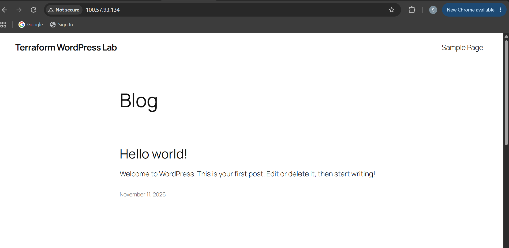
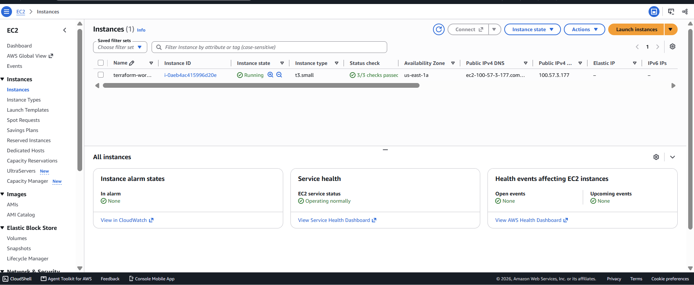

# Automated WordPress Deployment on AWS with Terraform

## Project Overview

Built and deployed a WordPress website on AWS using Terraform for infrastructure provisioning and a Bash user-data script for automated server configuration.

The goal was to replace manual EC2 setup and WordPress installation with a repeatable, Infrastructure as Code deployment.

## Tools & Technologies

- **Terraform:** Infrastructure provisioning and lifecycle management
- **Amazon EC2:** Hosting the WordPress application
- **AWS Provider:** Managing AWS resources
- **Bash:** Automating server configuration through EC2 user data
- **Apache:** Web server
- **MariaDB:** WordPress database
- **PHP:** WordPress application runtime

## What I Did

- Created Terraform configuration files to provision the AWS infrastructure.
- Used the AWS provider to define and manage infrastructure resources.
- Configured EC2 user data to execute a Bash installation script automatically.
- Automated installation and configuration of Apache, MariaDB, PHP, and WordPress.
- Used Terraform outputs to retrieve information about the deployment.
- Troubleshot deployment issues involving AWS Availability Zones and instance initialization.
- Verified the WordPress website was accessible through a browser.
- Practiced checking infrastructure drift and cleaning up provisioned resources.

## What Changed

**Before:** Deploying WordPress required manually provisioning AWS infrastructure and installing the application dependencies.

**After:** Terraform automated the infrastructure setup, while Bash user data automated the WordPress installation and initial server configuration.

This reduced manual deployment steps and made the setup easier to reproduce.

## Results and Verification

- Successfully deployed the WordPress application on AWS EC2.
- Confirmed the website loaded in a browser.
- Verified the default WordPress blog page displaying **"Hello world!"**
- Practiced Terraform infrastructure lifecycle management, including deployment verification and cleanup.

## Deployment Evidence

### WordPress Website

### AWS EC2 Instance

## Project Files

| File | Purpose |
|---|---|
| `main.tf` | Infrastructure resources |
| `provider.tf` | AWS provider configuration |
| `variables.tf` | Terraform input variables |
| `outputs.tf` | Deployment outputs |
| `user-data.sh` | Automated WordPress installation |
| `.terraform.lock.hcl` | Provider dependency lock file |

## Key Takeaways

- Automated infrastructure provisioning using Terraform.
- Combined Infrastructure as Code with Bash scripting.
- Practiced EC2 initialization and application deployment.
- Troubleshot configuration issues during deployment.
- Verified an application running on provisioned infrastructure.

## Future Improvements

- Move database hosting to Amazon RDS.
- Use a dedicated secrets-management solution.
- Add HTTPS using a managed TLS certificate and an appropriate application endpoint.
- Introduce an automated validation and deployment pipeline.