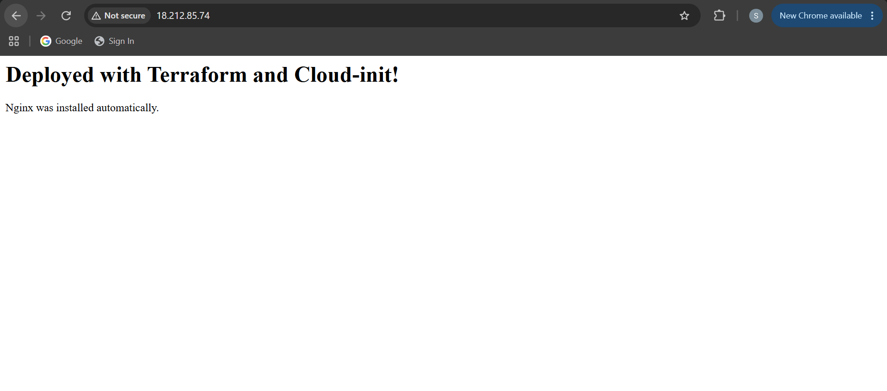

# Terraform EC2 Deployment with Cloud-init

## Overview

Automated the deployment of an AWS EC2 web server using Terraform and cloud-init, replacing manual infrastructure setup with Infrastructure as Code.

## Technologies Used

- **Terraform** — AWS infrastructure provisioning
- **Amazon EC2** — Hosting the web server
- **Cloud-init** — Automated instance initialization
- **Nginx** — Web server
- **AWS Provider** — Managing AWS resources through Terraform

## What I Did

- Created Terraform configuration files to provision an EC2 instance.
- Configured cloud-init to automate Nginx installation and web server setup.
- Used Terraform to deploy the infrastructure.
- Verified the deployment by accessing the web server through its public IP address.
- Practiced managing the infrastructure lifecycle using Terraform.

## What Changed

**Before:** Provisioning an EC2 instance and configuring a web server required manual setup.

**After:** Terraform defined the infrastructure, while cloud-init automated the web server configuration during instance initialization.

This made the deployment more repeatable and reduced manual configuration steps.

## Results

- Successfully provisioned an AWS EC2 instance.
- Automatically installed and configured Nginx using cloud-init.
- Verified the web server displayed the message **"Deployed with Terraform and Cloud-init!"** in a browser.

## Deployment Evidence

## Key Takeaways

- Practiced Infrastructure as Code using Terraform.
- Learned how cloud-init can configure an EC2 instance automatically.
- Combined infrastructure provisioning and instance initialization.
- Gained hands-on experience deploying and verifying AWS resources.